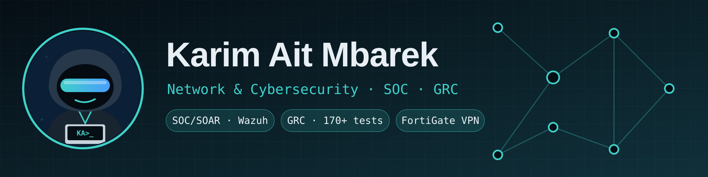

# Hi, I'm Karim Ait Mbarek 👋

**Engineering student · Networks, cybersecurity and AI** — ENIAD Berkane (Université Mohammed Premier)

🎯 Looking for a **4 to 6-month end-of-studies internship (PFE) starting January 2027**, in Morocco or abroad.

## What I build
- 🛡️ **Automated SOC/SOAR platform**: Wazuh → Shuffle → TheHive, IOC enrichment (VirusTotal, OTX), 100-point severity score, LLM false-positive check
- 📊 **GRC platform** (INGETEL internship): OpenVAS import, risk = CVSS × criticality × exposure, FastAPI + Streamlit, 170+ tests
- 🔐 **Site-to-site IPsec VPN** between two FortiGate firewalls with DMZ on EVE-NG
- 🏠 **Smart home IoT**: simulated sensors, MQTT, ThingsBoard Cloud

## Tech

## Skills
`Network security` · `Detection & response (SIEM/SOAR)` · `GRC` · `Hardening` · `Cryptography`
`Python` · `SQL` · `Java` · `C/C++` · `JavaScript` · `Git` · `Docker`

## Find me
🌐 Portfolio: https://karim1234ait.github.io
💼 [LinkedIn](https://www.linkedin.com/in/karim-ait-mbarek-95a936395/)
📫 karimaitmbarek@outlook.com
